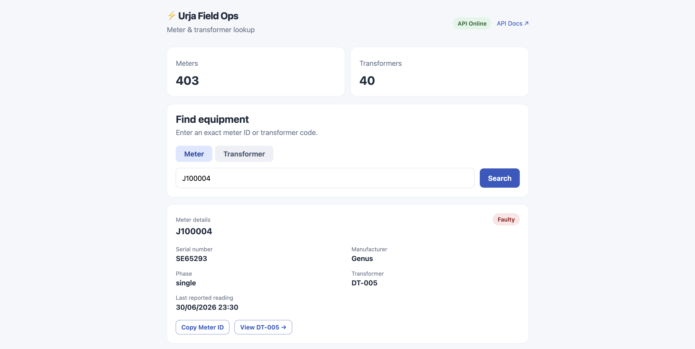
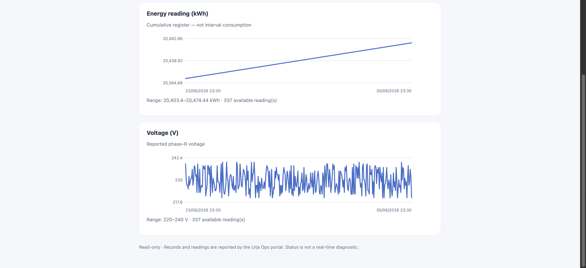
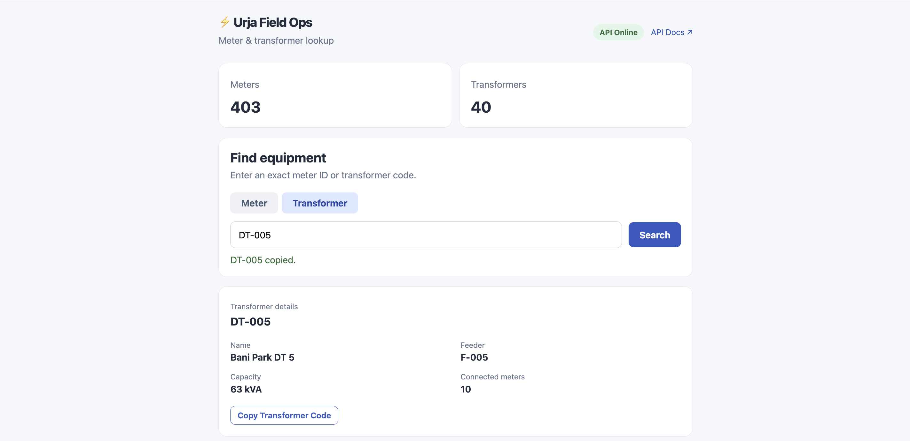
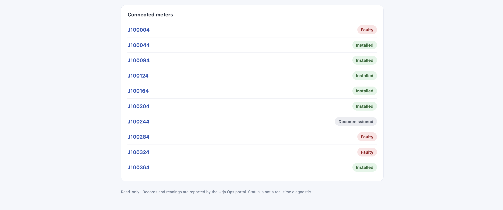
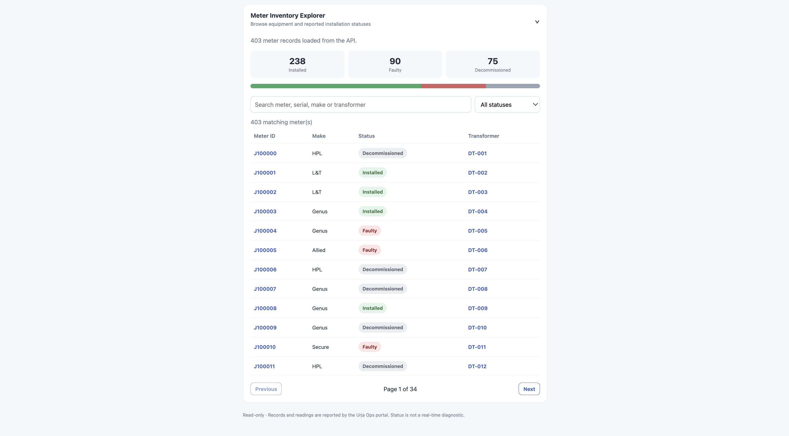

# ⚡ urja-telemetry-tracker-api

read-only Node.js REST API and lightweight field operations dashboard for legacy **Urja Meter Ops** portal. The backend authenticates to the portal through Playwright, extracts meter and distribution-transformer records, and exposes structured JSON. The frontend helps technicians search equipment, inspect recorded statuses and historical meter readings, and navigate transformer-to-meter relationships.

**Tech stack:** Node.js · Playwright · HTML · CSS · JavaScript · OpenAPI 3.1

## Field Operations Dashboard

The dashboard is intentionally minimal: **search → inspect equipment → review readings or connected meters**. It uses the existing REST API and does not require a separate frontend build or server.

- **Meter lookup:** Search by Meter ID; view serial number, manufacturer, phase, reported installation status, and associated transformer.
- **Transformer lookup:** Search by transformer code; view transformer name, feeder, capacity, and associated meters.
- **Simple graphs:** Historical cumulative **kWh** and recorded **phase-R voltage** for meters with readings.
- **Technician conveniences:** Copy equipment IDs, manually refresh, and see clear missing-data/error messages.
- **Overview:** Meter and transformer inventory totals and the local API process status.

> **Data interpretation:** `Faulty`, `Installed`, and `Decommissioned` are reported *installation statuses*, not real-time diagnostics. The graphs show historical portal readings, not a predictive health score. Transformer health is not inferred from the available metadata.

### Dashboard screenshots

The screenshots below show the read-only field interface. They illustrate meter and transformer searches and related details; displayed readings are historical records rather than live fault diagnoses.

**Meter J100004**





**Transformer DT-005**






### Meter Inventory Explorer

Browse all 403 smart meters through a searchable, paginated inventory. Filter by reported installation status, inspect the status distribution, and navigate directly to meter or transformer details.




## Getting started

### Requirements

- Node.js 20 or newer, npm
- Playwright Chromium (or installed Google Chrome with `BROWSER_CHANNEL=chrome`)
- Authorized read access to the Urja Meter Ops portal

```sh
npm install
npx playwright install chromium
cp .env.example .env
```

Edit `.env` with `PORTAL_USERNAME` and `PORTAL_PASSWORD`. **Never commit `.env`, browser sessions, or credentials.**

```sh
npm start
```

The service binds to `127.0.0.1:3000` by default.

| Local URL | Purpose |
| --- | --- |
| `http://localhost:3000/` | Technician-facing field operations dashboard |
| `http://localhost:3000/docs` | Interactive Swagger API documentation |
| `http://localhost:3000/openapi.json` | OpenAPI 3.1 contract |
| `http://localhost:3000/health` | API process health check |

Configuration options include `HOST`, `PORT`, `PORTAL_BASE_URL`, `CACHE_TTL_SECONDS`, `HEADLESS`, and `BROWSER_CHANNEL`. Set `HEADLESS=false` to watch browser automation during debugging. Keep the API bound to localhost unless downstream authentication and network protections are added.

## REST API

| Area | Endpoint | Purpose |
| --- | --- | --- |
| Meter inventory | `GET /api/meters` | Paginated inventory with optional `search` and `status` |
| Meter details | `GET /api/meters/{meterId}` | Nameplate, location, network path, and telemetry |
| Meter readings | `GET /api/meters/{meterId}/readings` | Reported meter readings |
| Transformers | `GET /api/transformers` | Paginated transformer inventory |
| Relationships | `GET /api/transformers/{code}/meters` | Meters linked to a transformer code |
| Service | `GET /health` | Local server process status |

Example queries:

```sh
curl 'http://localhost:3000/api/meters?page=1&limit=5&status=Installed'
curl 'http://localhost:3000/api/meters/J100000'
curl 'http://localhost:3000/api/meters/J100000/readings'
curl 'http://localhost:3000/api/transformers?page=1&limit=20'
curl 'http://localhost:3000/api/transformers/DT-001/meters?page=1&limit=10'
```

Example meter detail (abbreviated):

```json
{
  "id": "J100000",
  "nameplate": {
    "meterId": "J100000",
    "serialNo": "SE33962",
    "make": "HPL",
    "phaseType": "single",
    "installationStatus": "Decommissioned"
  },
  "networkPath": ["Jaipur Zone 1 (Z-01)", "Circle 1 (C-01)"],
  "location": { "latitude": 26.938961002479868, "longitude": 75.83095696146852 },
  "consumption": {
    "latest": "30/06/2026 23:30",
    "intervalMinutes": 30,
    "readings": [
      { "timestamp": "23/06/2026 23:30", "kwh": 48438.74, "kvah": 52313.84, "voltageR": 226 }
    ]
  }
}
```

See [`openapi.json`](./openapi.json) for the API contract and [`PROTOCOL.md`](./PROTOCOL.md) for portal investigation details. Swagger UI at `/docs` supports **Try it out** and loads its assets from `unpkg.com` (requires internet access for the documentation UI).

### Data semantics and validation

- **Telemetry:** `kwh` and `kvah` are cumulative meter registers, **not per-interval consumption**. The frontend plots original reported values; it does not calculate consumption differences. `voltageR` is reported phase-R voltage.
- **Timestamps:** Preserved as displayed by the portal; no UTC/IST timezone is inferred.
- **Network relationships:** Transformer `feederCode` and meter `transformerCode` provide logical associations, **not** a verified physical electrical topology.
- **Request errors:** Invalid pagination returns `400`; unknown assets return `404`; failed upstream extraction returns `502`.
- **Health endpoint:** `/health` confirms the local process is responding, not that the upstream portal is reachable.

## Architecture

```text
Urja Meter Ops portal (online)
             |
    Playwright authentication
       and page extraction
             |
    Node.js REST API + cache
         /           \
  Field dashboard    Swagger / JSON clients
  HTML/CSS/JS
```

- `src/portal.js` handles the authenticated Playwright browser, parsing, and serialized navigation.
- `src/server.js` serves read-only JSON endpoints, Swagger documentation, and dashboard files.
- `public/` contains the static dashboard and Swagger initialization script.
- `openapi.json` documents the supported API.

The portal presents 20 rows per page; the backend reads the observed pages to build inventory, then applies API pagination and filtering. API data is cached in memory for **30 seconds by default**, and the single browser page serializes access to avoid navigation races. This design is compact and simple, but limits concurrency and depends on the portal's markup.

## Tests

```sh
npm test
```

Tests cover selected request-processing behaviors. Browser extraction remains coupled to upstream HTML and would benefit from fixture-based integration tests.

## Assumptions, scope and trade-offs

- The authorized portal's list and detail pages are treated as the source of truth.
- The API and dashboard are **read-only**; credentials and browser sessions stay on the server.
- No new database, user accounts, write operations, predictive alerts, geospatial routing, or deployment infrastructure.
- The portal offers a bulk meter export, but this implementation traverses paginated UI records for consistent interpretation.
- Transformer-to-meter lookups use observed codes and do not imply complete physical network connectivity.
- Browser automation is a pragmatic bridge rather than a stable upstream integration contract.

## Reflection

**What assumptions did you make?** I used authenticated portal pages as the data source, assumed the configured operator has read access, and preserved timestamps without inventing a timezone.

**What was most difficult?** The task did not provide an API contract. I inspected meter details, telemetry tables, transformer inventory, and export behavior to establish the available data shape and relationships.

**What mistake did you make?** I initially interpreted an unloaded transformer table as empty. Triggering its export control completed the load, exposing the first 20 rows and confirming a second page.

**If you had another day?** I would verify a supported upstream integration interface, add captured-page tests and retry classification, compare bulk export to paginated data, and improve cache invalidation and operational logging.

**What would you criticize?** HTML scraping can break when portal markup changes, and one shared browser page limits throughput. A supported authenticated HTTP interface and fixture-based extraction tests would make this more robust.

## Security

Do not commit `.env`, passwords, cookies, browser storage, or traces. `.env.example` must contain placeholders only. The local API has no separate downstream authentication and should **not** be exposed publicly without appropriate access controls.
